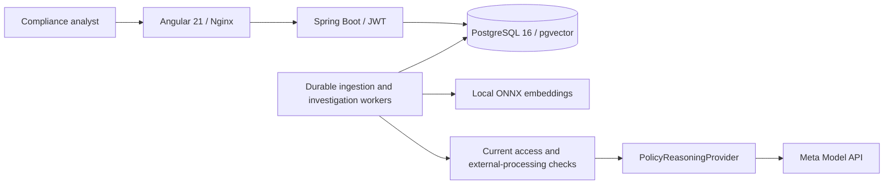

# Technical architecture

AI Policy Investigator compares an immutable replacement policy against its baseline
and explicitly selected procedures. It extracts structured requirements, identifies
potential conflicts and presents source-grounded findings for human review. There is
no generic chat endpoint or automatic policy modification.

## Components

The repositories are separate:

- Backend: [ThierryTe/ai-policy-invetigator](https://github.com/ThierryTe/ai-policy-invetigator).
- Frontend: [ThierryTe/ai-policy-invetigator-frontend](https://github.com/ThierryTe/ai-policy-invetigator-frontend).

Java 21, Spring Boot 4.1.1 and Spring AI 2.0.1 implement the backend. PostgreSQL 16
with pgvector 0.8.0 stores documents, vectors and investigation state. The frontend
uses standalone Angular components, signals, OnPush change detection and HttpClient;
RxJS handles asynchronous HTTP work. JWTs stay in memory rather than localStorage.

Python scripts are operator, verification and evaluation tools. They are not a
production API or a second inference service. The short-lived model initializer
uses the same pinned download/integrity implementation as the local setup.

## Persistent data and provenance

| Area | Main records |
|---|---|
| Identity | organizations, departments, app_users, memberships, policy_grants |
| Documents | policies, policy_versions, document_pages, chunks |
| Ingestion | ingestion_tasks, stages, leases, attempts and safe failures |
| Investigation | investigations, requirement_extractions, investigation_assessments, investigation_jobs |
| Human review | finding_reviews with reviewer identity, sequence, time and note |

A version stores original PDF bytes, content hash, predecessor, effective date and
indexing status. Pages and chunks preserve original source locations. Search-only
text cleaning never replaces canonical evidence. Existing versions are not edited
in place when an analyst uploads a replacement.

An investigation fixes its baseline, direct replacement, analysis date and selected
procedure versions. Checkpoints retain source hashes and model/prompt/schema metadata.
A changed model/source context invalidates incompatible checkpoints. The graph is
built from persisted versions, requirements, alignments and verified findings; graph
and evidence reads do not call a model.

## Authorization boundary

JWT authentication identifies the caller; current database identity, memberships and
policy grants determine permission. Role claims in a token are not permission grants.
The runtime database role is a non-superuser without BYPASSRLS. Protected tables use
forced row-level security and a transaction-scoped actor context across JDBC, JPA
and background workers. The separate migration owner does not serve normal requests.

Every investigation read requires access to every contributing version. Revoking a
source can therefore make the entire derived investigation inaccessible rather than
exposing a filtered graph that reveals hidden relationships. Inaccessible resources
return 404; invalid or disabled identities return 401.

Before each provider attempt, including retries, the worker checks current identity,
source access, replacement write permission, owning-department external-processing
consent, lease and budgets. It validates the response again before persistence.
An ADMIN in another department has no global access. Consent withdrawal prevents
later dispatch; it cannot retract material already sent in an authorized request.
A concurrent database permission change and external HTTP dispatch are not atomic.

## Separate embeddings and reasoning

Embeddings run locally using `all-MiniLM-L6-v2`, 384 dimensions. The pinned model,
tokenizer revision and hashes are in [model provenance](provenance/embedding-model.json).
The model files are outside source control and mounted read-only into Spring Boot.

`PolicyReasoningProvider` isolates reasoning from embeddings and the domain model.
The Meta implementation uses the account-verified `muse-spark-1.3` contract, HTTPS
bearer authentication and structured JSON output. It does not reuse OpenAI clients
or prompts. Account availability must be checked for each deployment.

Extraction preserves actor, action, obligation, condition, scope, deadline, exceptions,
effective date, explicit unknown/null fields and exact source ID/quote references.
The server assigns requirement IDs. Independent schema validation rejects fabricated
IDs, nonmatching quotations, malformed values and incomplete coverage.

Comparison aligns baseline/replacement requirements and assesses the selected
procedures as CONTRADICTION, MISSING_REQUIREMENT, AMBIGUITY or NO_CONFLICT. All
requirements in the bounded selected scope are compared; automatic enterprise-wide
procedure discovery is not implemented. Missing evidence and provider failure never
mean NO_CONFLICT.

Citations prove source correspondence, not correctness of interpretation. Actionable
findings require human review. Confirm, Dismiss and Add Note append separate events;
they preserve the original AI classification, reasoning and evidence.

## Durability and operational limits

Persistent jobs expose queued, running, completed, partial and failed states. Leases,
fencing and checkpoints support restart recovery and prevent stale workers from
committing. Idempotency keys prevent accidental duplicate submissions. Provider
concurrency, per-attempt timeout, retries and total investigation deadline are bounded.
Progress reports safe failure codes, latency and reported token usage without prompts,
PDF contents or credentials.

The MVP accepts one to four selected procedure versions. Conservative source/request
limits fail explicitly rather than silently truncating a document. A completed result
indicates processing coverage, not a guarantee of model accuracy. Reported provider
usage may omit a request that timed out after dispatch.

See the [API contracts](README.md), [recorded evaluation](EVALUATION.md) and
[production topology](DEPLOYMENT.md) for practical behavior and limits.
