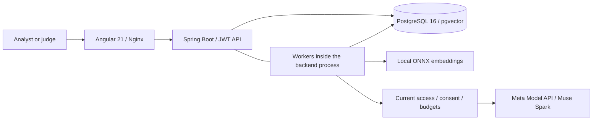

# Architecture

AI Policy Investigator compares a policy baseline, its direct replacement and one to
four selected procedure versions. Original PDFs, processing state, findings and human
reviews are persisted. This document describes the inspected implementation; it does
not certify which revision is currently running in production.

## Components and infrastructure

| Component | Responsibility |
|---|---|
| Angular 21 | Standalone components, signals, OnPush, HttpClient/RxJS, document workflow, findings, graph, evidence and reviews |
| Java 21 / Spring Boot 4.1.1 | Authenticated API, domain validation, parameterized JDBC/JPA and durable job processing |
| Spring AI 2.0.1 / ONNX | Local `all-MiniLM-L6-v2` embeddings, 384 dimensions; pinned model/tokenizer hashes |
| PostgreSQL 16 / pgvector 0.8.0 | Identity, permissions, original PDFs, page/chunk provenance, vectors, jobs and review history |
| Meta Muse Spark | Structured extraction, policy-change alignment and selected-procedure assessment through `PolicyReasoningProvider` |
| Docker / Compose | Backend, database, Angular/Nginx and a short-lived model initializer; persistent database/model volumes |
| GitHub Actions / GHCR | Test and image publication pipeline, with a separate manual production workflow |

The frontend is a [separate repository](https://github.com/ThierryTe/ai-policy-invetigator-frontend).
Python scripts provide operator, fixture, evaluation and verification tools; they are
not production API or inference services. Ingestion and investigation workers run inside
Spring Boot, rather than as separate deployed services. The initializer verifies pinned
model sizes/hashes and caches artifacts; the backend mounts model files read-only.

Production overlays expose only Angular/Nginx through the existing Nginx Proxy Manager.
The frontend proxies same-origin `/api` requests; backend and PostgreSQL have no production
host ports. Current CI/CD configuration publishes images separately from manual delivery.
Ordinary delivery validates the schema and refuses pending migrations; it is not a database
rollback mechanism. See [production operations](DEPLOYMENT.md) and the
[current pipeline](PRODUCTION_PIPELINE.md) for maintained operator procedures.

## Document and AI flow

1. An authorized upload stores original PDF bytes, SHA-256, effective date and an immutable
   version linked to its predecessor. A durable ingestion job extracts page text with
   PDFBox in a child JVM, creates page-aware chunks and calculates local embeddings.
   Search cleaning never replaces canonical evidence. No OCR pipeline is implemented.
2. The analyst selects indexed policy versions and procedures, an analysis date and
   explicitly allowed external processing. The server validates direct version lineage,
   effective dates, complete source access and bounded context before admission.
3. The investigation worker calls Meta `muse-spark-1.3` over HTTPS with bearer authentication
   and strict JSON Schema. It extracts every selected version's explicit requirements,
   preserving conditions, scope, deadlines, exceptions, unknown fields and source references.
4. A comparison call aligns baseline/replacement requirements and assesses each replacement
   requirement against every selected procedure. All source chunks in this bounded scope
   are supplied; vector search does not discover procedures or silently narrow the analysis.
5. The server assigns requirement IDs and validates schema, model identity, processing
   coverage, source IDs and exact quotations. It persists validated findings and provenance.
   Findings are `CONTRADICTION`, `MISSING_REQUIREMENT`, `AMBIGUITY` or `NO_CONFLICT`.
6. The API projects persisted requirements, changes and assessments into findings and a
   graph. Reading results/evidence makes no reasoning request. Confirm, Dismiss and Add Note
   append review events without replacing AI classifications, reasoning or citations.

## Persistence and recovery of jobs

| Records | Stored information |
|---|---|
| `organizations`, `departments`, `app_users`, `memberships`, `policy_grants` | Current identity and document scope |
| `policies`, `policy_versions`, `document_pages`, `chunks` | Original documents, lineage, pages, excerpts and vectors |
| `ingestion_tasks`, `investigation_jobs`, `investigations` | Persisted progress, attempts, leases, deadlines and safe errors |
| `requirement_extractions`, `investigation_assessments` | Structured output, source hashes and model/prompt/schema provenance |
| `finding_reviews` | Append-only reviewer identity, decision, note, sequence and timestamp |

Leases, fencing and extraction checkpoints support restart recovery and prevent stale
workers from committing. Changed source/model/prompt/schema context invalidates incompatible
checkpoints. UUID idempotency keys protect upload and investigation submissions; review
POSTs append events and must not be automatically retried. Investigations expose `QUEUED`,
`RUNNING`, `COMPLETED`, `PARTIAL` and `FAILED`; completion describes processing coverage.

Provider defaults are a 30-second per-call timeout, two retries, concurrency two, a
240-second investigation budget and 4096 completion tokens. Application configuration
accepts 4096–8192 completion tokens; this does not prove provider support for a higher value.
Context limits fail explicitly rather than silently truncating documents. Reported usage
can omit a timed-out request. Diagnostic events contain safe counters/codes, not source
text, prompts, refusal text or credentials.

## Authentication and authorization

The current frontend retains token/absolute expiry in tab-scoped `sessionStorage`, with
an in-memory session. On reload it verifies identity with `/api/auth/me` before protected
views render; it does not extend expiry or call a refresh endpoint. Logout/expiry clear
authentication and protected state. There is no localStorage token. See the frontend's
[authentication guide](https://github.com/ThierryTe/ai-policy-invetigator-frontend/blob/main/docs/AUTHENTICATION.md).

Current database identity, memberships and grants determine access. The runtime role is
a non-superuser without BYPASSRLS; protected tables use forced row-level security and
transaction-scoped actor context across JDBC, JPA and workers. A separate owner runs migrations.
Derived investigation reads require access to every contributing version. Missing source
access yields 404; disabled/invalid identities yield 401. UI button visibility is not authority.

Before each model attempt, including retries, the server rechecks source access, analysis
permission, owning-department consent, lease and budgets. V8 permits bounded analysis of
authorized shared sources by judges without granting source WRITE access. Shared document
edits, consent changes and source-department reviews remain restricted. Consent withdrawal
cannot retract already transmitted material; database permission changes and external HTTP
dispatch are not atomic. Swagger and dotenv remain disabled in production.

## API boundary

The client flow is login/identity → policies/versions → ingestion polling → consent →
investigation submission/polling → requirements/findings/graph/evidence → human review.
Protected PDFs are fetched as authenticated bytes and displayed through temporary blob URLs.
Snake_case SQL fields and camelCase request/review/graph DTO fields remain distinct.

Detailed contracts: [documents and authentication](api/phase2.md),
[consent and investigations](api/phase3.md), and [graph and reviews](api/phase4.md).
Recent investigation IDs exist only in session memory and are revalidated through the
existing progress endpoint. There is no server investigation-list, evaluation-feed,
report-export or notification endpoint. See [Testing](TESTING.md) for reproducible checks,
recorded outcomes and the unvalidated Remote Work scenario.
